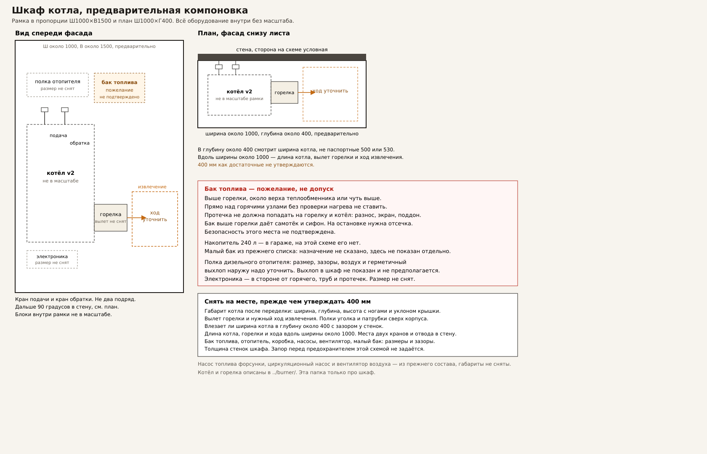
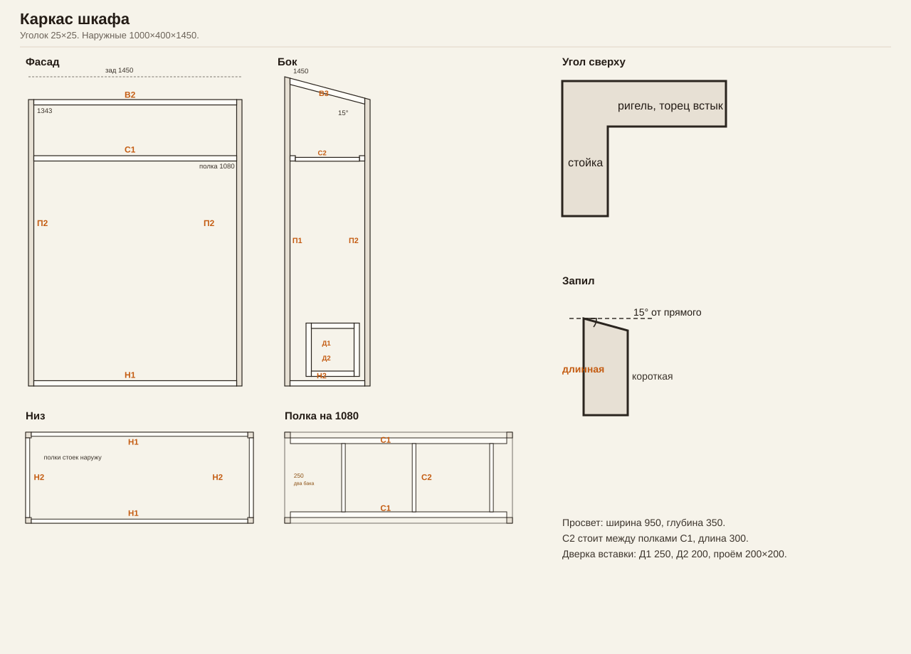

# Шкаф уличного котла

Компоновка [Котла v2](../burner/README.md#котёл-v2).

Чертёж: [компоновка](./компоновка.svg). Каркас: [каркас](./каркас.svg).

Шкаф **1000×400×1450** мм по заднему краю крыши. Крыша вперёд на **15°**, передний край **1343** (1450 − 400·tg 15° = 1342,8). Котёл боком: высота **700**, верх **335×200**, до полки **380**, шов сзади **590** и спереди **630**. Над котлом крышка **150**. Дымоход **Ø115** с плавными изгибами: вверх у задней части крышки, под полкой вправо, вдоль правой стенки вверх и наружу через правую стенку. Ось выхода на схеме **1240** от пола. Горелка: квадрат **180** наружу, внутрь **150**. Снятие — вытянуть на **150**: весь узел **330** остаётся внутри и выносится через фасад. Боковая дверка на той же оси — для вставки **94×94**, проём рамки **200×200**.

Подача и обратка с заднего торца, кран, **90°** в стену. Над горелкой площадки подачи и наддува. Полка на **1080** от пола, на всю ширину просвета. Слева полоса **250**: снизу бак горелки, над ним бак отопителя. Это разные баки, контуры не соединяются. Бак отопителя ниже полки, сам отопитель стоит на полке. От крышки котла (**850**) до полки в полосе **230** мм. Высоты баков не заданы, черта между зонами не размер. Два бака в эти 230 мм не подтверждены. Заливка с фасада. Полоса не пересекает снятие горелки и дверку вставки. На полке отопитель **435×216×177**, верх **1257**. Электроника у фасада. Накопитель **240** л в гараже.

Наружная ширина **800** не собрана. Просвет был бы **750**. Снятая горелка **330** и котёл до наружной полки **380** занимают **710** от левой стойки. До правой стойки остаётся **40**. Труба **Ø115** в эти 40 мм не входит. Длина кранов не измерена. Вплотную, только по трубе и двум стойкам, наружный предел **875** (25+710+115+25). Это не размер шкафа. В схеме оставлено **1000**: просвет **950**, за задним торцом **240**.

## Каркас

Уголок **25×25**, толщина не задана и в длины не входит. Стойки по наружным углам, обе полки наружу. Ригели встык к внутренней грани стойки: длина ригеля равна просвету. Низ стоек **90°**. Верх стоек — рез **15° от прямого** (полотно на 15° от перпендикуляра к оси, то есть **75° к оси**). Мерить длинную кромку. У **П1** длинная кромка — наружный задний угол. У **П2** длинная кромка на 25 мм от переднего угла внутрь, наружный передний угол при этом 1343. **В3** — оба реза 15° от прямого и параллельны, длина по продольной кромке одинакова на обеих полках.

Полка: **С1** спереди и сзади на 1080, между стойками. **С2** три поперечины между полками **С1** (полка уголка 25 мм с каждой стороны, 350−50 = 300). Рамка дверки в левой стенке, в обшивку: **Д1** наружная высота рамки, **Д2** между стойками рамки.

| Поз. | Что | Длина, мм | Шт. | Рез А | Рез Б | Кромка |
| --- | --- | --- | --- | --- | --- | --- |
| П1 | Стойка задняя | 1450 | 2 | 90° | 15° от прямого | длинная, наружный задний угол |
| П2 | Стойка передняя | 1350 | 2 | 90° | 15° от прямого | длинная; расчёт 1349,5 |
| Н1 | Низ, по ширине | 950 | 2 | 90° | 90° | любая |
| Н2 | Низ, по глубине | 350 | 2 | 90° | 90° | любая |
| В1 | Верх, зад | 950 | 1 | 90° | 90° | любая |
| В2 | Верх, перед | 950 | 1 | 90° | 90° | любая |
| В3 | Верх, скат | 362 | 2 | 15° от прямого | 15° от прямого, параллельно | продольная; расчёт 362,3 |
| С1 | Полка, вдоль | 950 | 2 | 90° | 90° | любая |
| С2 | Полка, поперёк | 300 | 3 | 90° | 90° | любая |
| Д1 | Дверка, стойка | 250 | 2 | 90° | 90° | любая |
| Д2 | Дверка, ригель | 200 | 2 | 90° | 90° | любая |

Сумма длин **14,52 м**. Площадок подачи и наддува, обшивки, настила и петель в ведомости нет: габарит подачи и наддува не задан.

Короткая кромка **П1** — 1443. Это не длина заготовки.

## Хлысты 3000

Пропил не задан. Ниже допуск **3 мм на рез**: одна торцовка и по резу на деталь. Сверх этого критичный хлыст указан отдельно.

| Хлыст | Порядок | Сумма, мм | Резов | Пропил 3 мм | Занято | Остаток | Пропил не больше |
| --- | --- | --- | --- | --- | --- | --- | --- |
| 1 | П1, П1 | 2900 | 3 | 9 | 2909 | 91 | 33 мм |
| 2 | П2, П2, Д2 | 2900 | 4 | 12 | 2912 | 88 | 25 мм |
| 3 | Н1, Н1, Д1, Д1, Д2, С2 | 2900 | 7 | 21 | 2921 | 79 | 14 мм |
| 4 | В1, С1, С1 | 2850 | 4 | 12 | 2862 | 138 | 37 мм |
| 5 | В2, Н2, Н2, С2, С2 | 2250 | 6 | 18 | 2268 | 732 | 125 мм |
| 6 | В3, В3 | 724 | 3 | 9 | 733 | 2267 | — |

Два задних стояка **1450+1450** садятся на один хлыст: до пропила остаётся 100 мм. На хлыст уходит **6×3000 = 18 м**. Если пропил хлыста 3 больше 14 мм, последнюю **С2** перенести на хлыст 5.

К распилу не готов: пропил станка не измерен, толщина уголка не задана, несущая способность не считалась. Не заданы длина кранов, высоты обоих баков и тепловые зазоры. Отдельного уголка между баками нет. Ось выхода 1240 — точка этой схемы.
