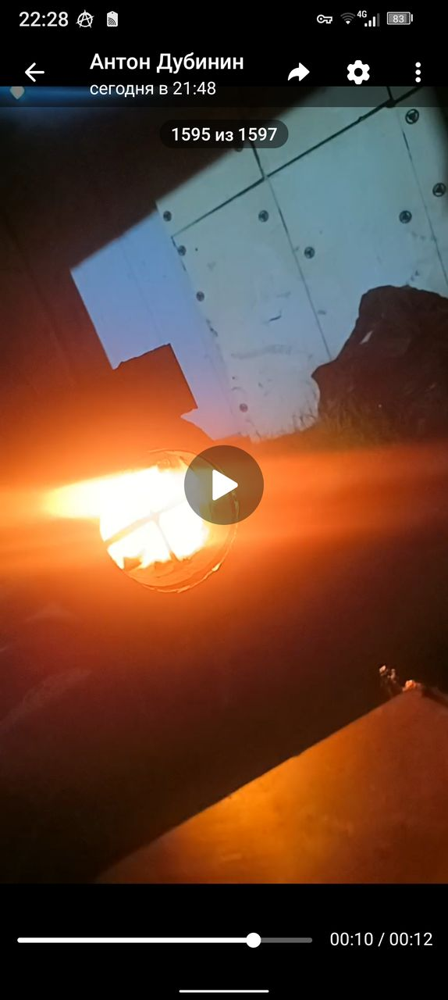
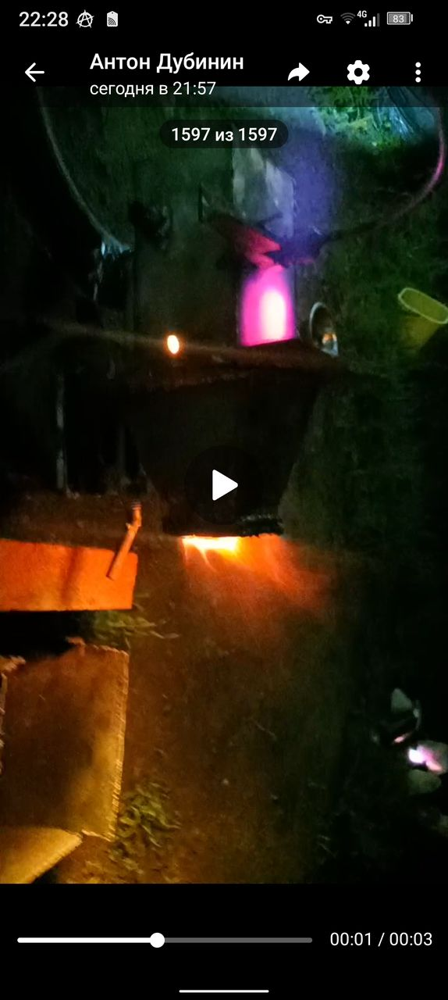
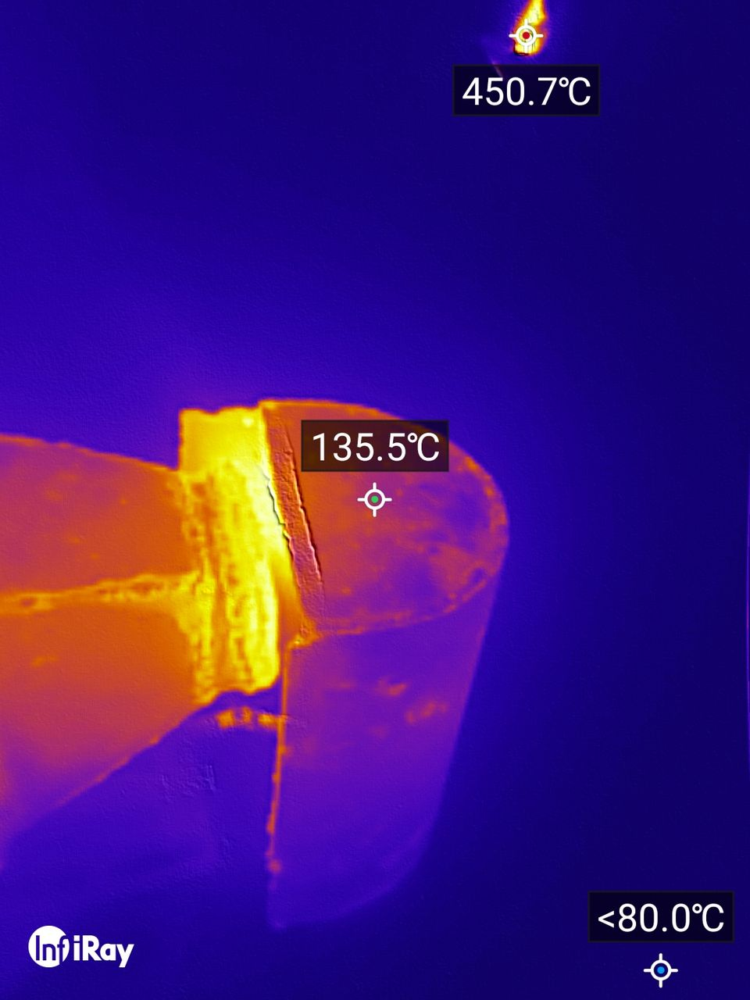
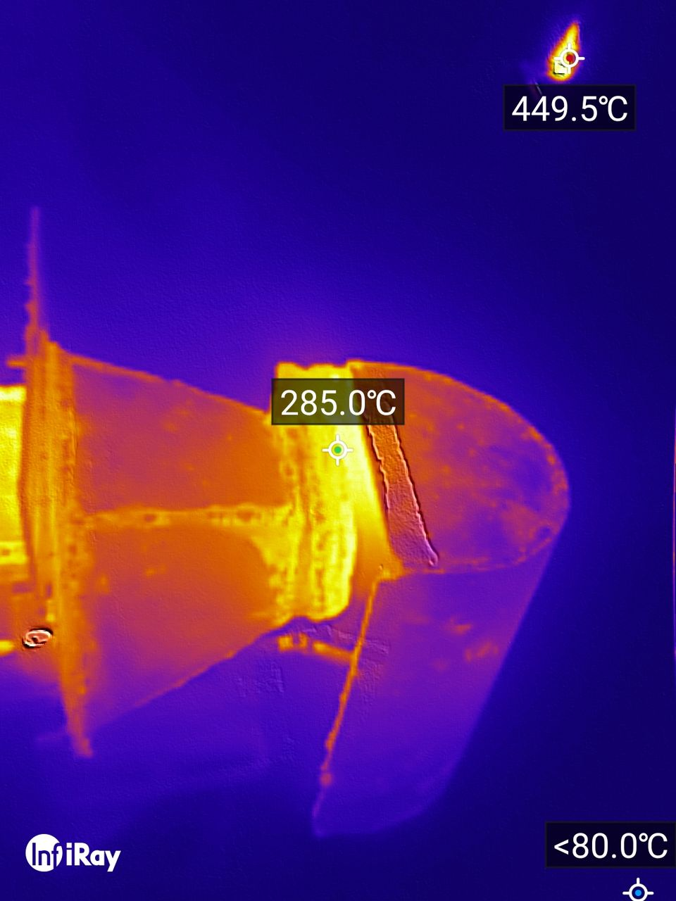
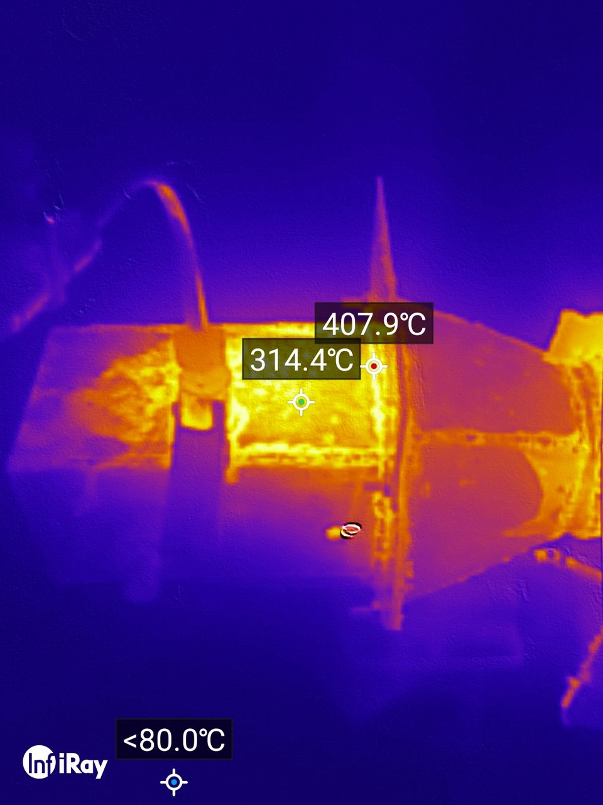

# Жидкотопливная горелка и котёл из кеги 30 л

Документация горелки с принудительным воздухом и испарительной чашей, плюс теплообменник: горизонтальная нержавеющая кега 30 л и жаровой стакан внутри. Ориентир съёма с одной кеги — порядка **10 кВт**.

Схемы горелки: [разрез с размерами (PDF)](./горизонталка_размеры.pdf), [номера](./горизонталка_номера.svg), [блоки установки](./схема-блоков.svg). Модель: [горизонталка.scad](./горизонталка.scad) — в SCAD круглая труба Ø90, по факту выход **Ø100**.

---

## Конструктивные узлы горелки

Чертёж с номерами — вставка v2. Вставка v1 снята после запуска №5; старые номера — в журнале запусков и в git. На чертеже: фланец **(1)**, смотровое **(2)**, кожух **(3)**, щель в кожух **(4)**, труба 45° **(5)**, циклон **(6)**, крест **(7)**, штуцер **(8)**, чаша **(9)**, зазор **(10)**, первичные отверстия **(11)**, вторичные **(12)**, керамическая пластина **(13)**, датчик **(14)**.

### 1. Внешний модуль (за пределами котла)

* **Корпус:** профильная труба **100×100 мм**.
* **Нагнетание:** турбовентилятор (улитка Kiturami, мотор от аккумуляторной болгарки, ESC 3S, БП 12 В). Труба 45° **(5)** в нижний короб, дальше воздух идёт в зазор под чашей **(10)** и в щель **(4)**.
* **Щель в кожух (4):** **80×15 мм**, **1200 мм²**. В модели был круг **Ø18**. Три отверстия Ø20 в Вентури — сняты со вставкой v1.

### 2. Внутренняя вставка

Вставка v1 (чаша + Вентури) после запуска №5 снята. Номера и описание — в журнале запусков и в git. Ниже — v2.

* Испарительная чаша **(9)**, горение начинается в самой чаше. Справа почти до фланца, правая стенка около середины высоты; от неё пластина до низа канала, чтобы воздух не обходил чашу.
* **Первичный воздух (11):** по бокам и на задней стенке у перегиба. Ряды на разной высоте, чтобы при любом уровне масла часть воздуха шла над поверхностью.
* **Вторичный воздух (12):** два ряда на задней стенке выше перегиба. Толкает пламя вперёд.
* **Дожиг:** циклон **(6)** и крест **(7)** остаются; площадь отверстий циклона увеличить (больше отверстий или больший диаметр).
* **Оценка площадей (приближённо, под 10 кВт):** масло ~0.86 кг/ч; воздуха при избытке ~25 % ≈ 18 кг на кг масла → ~3.6 л/с. Давление вентилятора не замерено; при 200–500 Па и коэффициенте расхода отверстий ~0.65 суммарная площадь ~200–300 мм². Распределение примерно: первичный ~30 % (≈ 70–90 мм², напр. 10–12 × Ø3), вторичный ~35 % (≈ 70–100 мм², напр. 3–4 × Ø6), циклон ~35 % (≈ 70–100 мм², напр. 20 × Ø2.5 или 12 × Ø3.2; сейчас ~60 мм²). Сверлить на нижней границе и рассверливать по результатам тестов.

**Раскладка отверстий (первый вариант, до сборки):** по 8 × Ø2.5 с боков и 5 × Ø2.5 сзади снизу, вторичные 5 × Ø4 одним рядом сверху. Итого ≈ 226 мм². На сборке заменено тем, что ниже.

**Фактическая сборка — 18.10.2026:**
- Донор — вставка v1. Верх чаши v1 срезан плазмой. Новая чаша шириной около **60–70 мм**: боковые пластины сначала идут вертикально, выше перегиба расходятся наружу и садятся в корпус вставки. Осталось просверлить отверстия и приварить чашу к основанию.
- Первичный воздух **(11):** по **9 × Ø2.5** с каждого бока (18 шт.), нижний ряд на **7–8 мм** ниже перегиба. Сзади на перегибе **3 × Ø2.5**. Вместе 21 × Ø2.5 ≈ **103 мм²**. Два отверстия Ø2.5 от v1 в верхней части боковин не заварены, ≈ **10 мм²**.
- Вторичный воздух **(12):** на задней стенке, на **10 мм** выше перегиба **2 × Ø4**, ещё на **10 мм** выше **3 × Ø4**. Вместе 5 × Ø4 ≈ **63 мм²**.
- Циклон **(6)** без изменений, 12 × Ø2.5 ≈ **60 мм²**.
- Сумма ≈ **236 мм²**. Регулировка — оборотами вентилятора (турбина и корпус Kiturami, мотор от аккумуляторной болгарки, ESC 3S, БП 12 В).

* **Конструкция:** чаша **(9)** слева до верха канала и сверху сходится с изогнутой задней стенкой; борт вверх, выше перегиба развал. Вправо почти до фланца, правая стенка до середины высоты, от неё затвор до низа. Воздух снизу, зазор **(10)**, дальше только через отверстия. Общая конструкция горелки почти не меняется.
* **Розжиг:** газовая растопка не нужна — в чашу кладётся салфетка и поджигается, чаша прогревается сама. Электроподжиг снят. Поджигать при выключенном или минимальном вентиляторе и прибавлять обороты, когда чаша прогреется и масло начнёт парить.
* **Датчик пламени (14):** термобатарея M10×1 на верхней стенке ближе к концу. Там самое горячее место — проверить, что термобатарея выдержит температуру; погасание будет замечено чуть позже.
* **Керамическая пластина (13):** **10 мм**, по габариту верхней пластины, впритык к фланцу, правый край над правой стенкой чаши. Подвижная, снимается. На запуске №6 верх вставки и кожух за штуцером топлива раскалились до свечения. На старте пластину можно сдвинуть и достать горелкой до чаши. В работе закрывает верх корпуса и прижимает факел к чаше; горячая керамика светит в чашу и помогает маслу парить. Не кафель: кордиерит, шамот или вермикулитовая плита. Крепить с зазором на расширение — лапки или шпильки, без жёсткого зажима. Проверить, что пластина не закрывает датчик **(14)** от пламени.

### 3. Жаровая часть горелки (входит в стакан котла)

* **Фланец на крышку кеги:** стойка **(1)** — часть этого фланца. **(2)** — вырез во фланце под смотровое; закрывается шторкой или герметичным окном с жаропрочным стеклом.
* **Переходник:** квадрат 100×100 → круглая труба **Ø100 мм**.
* **Кожух циклона (3):** от своего фланца к круглой трубе. Фланец прижимается к фланцу горелки: куски шпилек из нержавейки вварены, зажим гайками. Питается щелью **(4)** из нижнего короба. Жаровая труба **Ø100** приварится к этому кожуху, отдельно съёмной не будет.
* **Циклон (6):** **12** отверстий **Ø2.5 мм**, около **60 мм²**, всегда открыты. Последний воздух в горелке; в котле подмеса больше нет. В модели было **25×Ø2.5**. Воздух из кожуха закручивает факел.
* **Крест (7):** полоса **2.5 мм**, в **5 мм** перед рядом **(6)**.

---

## Регламент запуска

Вставка v2, салфетка, без газа.

1. Датчик пламени в режим ожидания.
2. Вентилятор выключен или на минимуме. Салфетка в чаше **(9)**, поджиг.
3. Чаша прогревается, подача масла. Когда масло парит — обороты вверх.
4. Датчик **(14)** видит устойчивое пламя. Обороты — под рабочую мощность.

---

## Котёл (теплообменник)

Горизонтальная кега **30 л, нержавейка ~1.5 мм** — водяная рубашка. Внутри — жаровой стакан **Ø200 мм, стенка 2.5 мм**. Горелка (Ø100) на **передней крышке**. Дымоход врезан в **обечайку кеги сверху**, примерно **50 мм** от этой крышки: гильза через водяную рубашку в стакан (швы к кеге и к стакану). Вода только между кегой и стаканом; газы внутри стакана.

Ход газов: факел в заднюю стенку, реверс **по своду** к дымоходу, у козырька огибание вниз и в трубу. Ориентир съёма с одной кеги — порядка 10 кВт. Вторая кега на выхлопе — позже, конвективная секция.

### Задник

Не 2.5 мм, а диск из дна нержавеющей сковороды **~5 мм**, если дно **монолитное** (не сэндвич с алюминием). Слабый магнетизм при отказе индукции — нормально для аустенита после штамповки; варить как 304 (308L / 309L).

Задник **мокрый**: снаружи вода, щель до днища кеги **25–40 мм**, чтобы не встать паровая подушка. Сухой диск в факеле прогорит независимо от толщины. Выпуклость сковороды удобнее вогнуть к факелу (пузо в воду). Борта сковороды не нужны — только круг под Ø200.

### Козырёк

Пластина внутри стакана, сверху, **правее дымохода** (глубже в топку). Реверс по своду упирается в неё, огибает снизу и уходит в трубу. Нижняя кромка выше оси горелки. На виде спереди — сектор по верхней дуге стакана.

На первом огне можно без козырька. Кольца и шнек **в факеле** не ставить.

### Обвязка (минимум)

* подача сверху / сзади рубашки, обратка снизу;
* воздух в верхней точке и предохранительный клапан;
* расширительный бак;
* не гонять котёл ледяной обраткой (смеситель или большой объём системы).
* Для отработки клапан «как у газа, строго 60 °C» не панацея: сера даёт более высокую кислотную точку росы. Клапан всё равно полезен, чтобы не кормить теплообменник холодной водой.

---

## Топливо

Трасса к форсунке собрана. От тройника (форсунка + датчик давления, вход M10) медная трубка на фильтр, от фильтра до насоса снова медь, от насоса до бака — полиамид.

Бачок ещё собрать: снизу слив, сбоку прозрачная трубка уровня на двух фитингах с тройниками — слив и уровнемер на **1/4**. Сверху штуцер **1/2** под слив перелива и дюймовая горловина. Поплавковый датчик уровня. Отвод воздуха с бака на вход вентилятора, чтобы пары шли в топку с воздухом, а не в помещение.

---

## Результаты тестов

### Запуск №1 — 12.10.2026
**Изменения перед тестом:** жаровой трубы и циклона **(8, 12)** нет; проход **(9)** открыт, кожуха нет.

**Топливо:** чистое масло, затем растворитель.

**Ход:** на режим не вышел. Чистое масло не завелось; с растворителем слабое пламя в районе Вентури, сильнее не разгоралось.

**Выводы:**
- Открытый проход **(9)** без кожуха — дыра из короба мимо эжекции, не хватает тяги, чтобы затягивать пары из чаши в Вентури.

**Дальше:**
- Кожух и фланец уже есть: **(9)** кормит кожух, не улицу.

### Запуск №2 — 12.10.2026
**Изменения перед тестом:** подправлено сопло Вентури (поток воздуха прямо); доделан кожух циклонки (8).

**Топливо:** растворитель, разовая заливка в чашу.

**Ход:** розжиг газом ~1 мин, вентилятор на минимуме. Пламя растворителя вспыхивало, но при убирании газа сразу гасло. Устойчивое пламя начало появляться, когда растворитель в чаше уже заканчивался.

**Выводы:**
- Жара растворителю хватает; проблема — недостаточный прогрев тракта и отсутствие постоянной подачи.
- Минимальные обороты вентилятора на переходе всё ещё сносят слабое пламя.
- Газ убирать плавно, только когда жидкое топливо держится само.

**Дальше:**
- Капельная подача: бензостойкая трубка, металлический участок у штуцера (4), игольчатый краник, отсечка.
- Прогрев газом дольше (несколько минут), особенно для масла.
- Регулировка воздуха ниже минимума на старте (заслонка).
- При необходимости — стабилизатор пламени за Вентури.

### Запуск №3 — 14.10.2026
**Изменения перед тестом:** добавлены пластина **(14)** (попытка flame holder) и крест **(15)** перед отверстиями циклона; капельная подача.

**Ход:** практически без улучшений. Слабое пламя держалось только на экстремально минимальных оборотах вентилятора (почти не дул): пламя шло из засоса **(6)** вперёд и затягивалось обратно в Вентури. При малейшей прибавке воздуха срывалось, дальше только дым вперёд.

**Наблюдения:** щель сопла **(3)** неровная — в середине почти сомкнута, сверху и снизу шире, кромки в окалине; струя рваная. Сужение после сопла через 20–30 мм; вертикальное расширение до пластины **(14)**, за ней второе сужение лопаткой **(11)** — по сути два горла подряд, смесь снова разгоняется там, где должно стоять пламя.

**Выводы:**
- Уменьшать площадь сопла в разы не первоочередно: скорость струи и так выше скорости горения, срыв станет сильнее.
- Пламени не за что зацепиться: после пластины **(14)** нет зоны торможения, лопатка **(11)** разгоняет поток.
- Дым вместо огня — пары есть, но смесь не горит; вероятно, чаша остывает после снятия газа (нет обратной связи по теплу).
- Широкий канал **(2)** даёт слабое разрежение у среза сопла.

**План на запуск №4** (менять по одному):
- Выровнять щель сопла **(3)** подгибом пластин по щупу, 1.5–2 мм по всей длине, кромки зачистить.
- Отогнуть лопатку **(11)**, чтобы за пластиной **(14)** поток расширялся, а не сужался.
- Насверлить отверстия в лопатке **(11)**, чтобы работала как стабилизатор.
- Термопара на чашу — смотреть, остывает ли после снятия газа.
- На будущую версию: съёмное сопло (вставка на фланце/винтах), чтобы менять варианты без распила.

### Запуск №4 — 16.10.2026
**Изменения перед тестом:** новое сопло **(3)** — пластина шириной 95 мм с 6 зубцами высотой 2.5 мм, 5 каналов = 5 ровных струй вдоль нижней кромки (суммарно на глаз порядка 35–40 мм², не замерялось); нижняя часть Вентури выпрямлена; всё обварено без щелей. По ходу теста доработана передняя часть чаши: 5–6 треугольных вырезов, засос **(6)** сильно увеличен.

**Ход:** с новым соплом эффекта ноль. После увеличения **(6)** — коптящее горение в чаше, немного дыма в Вентури. Пламя в чаше и дым в Вентури на обороты вентилятора практически не реагировали. Масла ~100 г за 10 мин (~0.6 кг/ч, ~7 кВт), сгорело не всё. Контрольный опыт: камера между **(11)** и **(12)** набита картоном — пламя мощно идёт вперёд, циклон работает; вентилятор мощный.

**Выводы:**
- Воздушный тракт и циклон работают; форма сопла не главная причина.
- Узкое место — испарение и подача паров: Вентури почти не затягивает пары, а в чаше воздух только самотёком через **(6)** (отсюда копоть и независимость от оборотов).
- Вероятно, чаше не хватает температуры (нужно 300+ °C): масло испаряется не полностью, факел чашу не греет, воздух под чашей может её охлаждать.

**Дальше:**
- Измерить температуру дна чаши (тепловизор — по участку с чёрной жаростойкой краской или каптоном, нержавейка занижает; либо термопара).
- Если холодная — греть чашу собственным пламенем и/или убрать охлаждающий поток снизу.
- Рассмотреть схему «горение в чаше + вторичный воздух из сопел/циклона на дожиг»: больше (подогретого) воздуха в чашу, чтобы в Вентури выходило уже горящее пламя.

### Запуск №5 — 17.10.2026
**Ход:** горения добиться удалось, пламя синее (смесь правильная), но без стабилизатора срывается при малейших колебаниях. Тяга паров из чаши в Вентури практически отсутствует: как ни грел, пламя не доходило даже до циклона **(12)**.

**Итог:** схема с эжекцией паров воздушным Вентури не работает. **Вариант закрыт, текущая вставка (чаша + Вентури, три ступени воздуха) выводится из работы.**

### Запуск №6 — вставка v2, тест 1 (19.10.2026)
**Изменения перед тестом:** вставка v2, чаша в доноре v1. Верхней пластины **(13)** не было. Розжиг салфетками, без электроподжига.

**Ход:** заметно лучше всех прошлых запусков. На режим около **5 мин**. В чашу — салфетки, пропитанные холодным маслом, и немного масла сверху; масло очень густое. Коротко прогрел газовой горелкой, чуть занялось. Вентилятор примерно на **1/3** воздуха — пошло вверх. Через краник топливо шло буквально по капле: на этом факел дотягивался до циклона **(6)**.

Потом шприцем вдавил около **50 мл** и воздух почти на максимум: пламя вышло за срез горелки, примерно на **10 см** вперёд. На полной мощности горело, пока это масло не кончилось.

**Наблюдения:** без пластины **(13)** кожух циклона за штуцером топлива раскалился до свечения. Тепловизор: корпус вставки за штуцером около **314 °C**, у фланца около **408 °C**; кожух циклона сначала **135 °C**, позже **285 °C**. Голая блестящая сталь светит слабо, показания ИК занижены.

За правой стенкой чаши факел резко уходит вниз и закручивается — зона рециркуляции за стенкой и затвором под ней, перед циклоном. Дальше пламя идёт в циклон. Эта рециркуляция держит факел, как стабилизатор.

После запуска в чаше почти не осталось нагара. Почти всё унесло вперёд и осело небольшим белым налётом, он легко счищается. На прошлогодней горелке нагар в чаше был проблемой; с v2 чистить должно быть заметно проще.

**Выводы:**
- Схема v2 работает: горение в чаше держится само, факел доходит до циклона и проходит его, на воздух реагирует.
- Розжиг салфетками в масле и короткий прогрев горелкой достаточен. Электроподжиг не нужен.
- Белый налёт — минеральная зола присадок (соединения кальция и цинка). Кокса и сажи мало: масло почти полностью испаряется и сгорает.

**Дальше:**
- Перед следующим запуском поставить пластину **(13)**: керамика **10 мм**, подвижная. Прижать факел к чаше и закрыть верх кожуха. На розжиге можно сдвинуть. Не кафель — кордиерит, шамот или вермикулит; зазор на расширение; не закрывать датчик **(14)**.
- Непрерывная подача — главное. Капля из краника держит факел только до циклона; полная мощность была от порции шприцем. На **10 кВт** около **0.86 кг/ч** масла — это примерно **16 мл/мин** (порядка 4–5 капель в секунду или тонкая струя). Открыть краник сильнее или греть масло в магистрали и откалибровать подачу (замерить мл/мин).
- Датчик **(14):** старое место со вставки v1, порт у фланца, свободно. После остывания сравнить его с верхней стенкой и оставить то, что лучше.
- На полной мощности, если воздуха мало: увеличить отверстия циклона **(6)** (12×Ø2.5 ≈ **60 мм²** → Ø4 ≈ **150 мм²**) и верхний задний ряд вторичных **(12)**. Менять по одному. Сначала устойчивая подача на нужный расход, потом на максимуме смотреть цвет, сажу и длину факела за срезом. Если коптит или факел длинный — сначала циклон, потом верхний задний ряд.

---

## Порядок сборки и прогресс

### Горелка

- [x] Пластины вставки
- [x] Сердечник сварен, без циклона
- [x] Короб воздуха, труба, сужение за фланец
- [x] Посадка форсунки, тройник, датчик давления, вход M10
- [x] Отверстие и штуцер газа (v1, не используются)
- [x] Вентилятор: улитка Kiturami, мотор аккумуляторной БШМ BLDC
- [x] Трасса масла: медь тройник–фильтр–насос, полиамид насос–бак
- [ ] Бачок: слив и уровнемер 1/4, перелив 1/2, горловина 1", поплавок, пары на вентилятор
- [x] Фланец на горелке
- [x] Кожух циклона со своим фланцем, прижимается к фланцу горелки
- [x] Шпильки на фланце кожуха, зажим гайками
- [ ] Круглая жаровая труба, приварить к кожуху циклонки
- [x] Отверстия циклона: 12×Ø2.5, всегда открыты
- [x] Вставка v2: чаша из донора v1, ширина 60–70 мм, борта вверх и развал
- [ ] Просверлить отверстия v2: 9×Ø2.5 с бока, 3×Ø2.5 и 5×Ø4 сзади
- [ ] Приварить чашу к основанию вставки
- [x] Первый тест вставки v2 (запуск №6, 19.10.2026): горение в чаше, факел до циклона и за срез; без пластины (13)
- [ ] Керамическая пластина (13), 10 мм, подвижная, впритык к фланцу — до следующего запуска. Кордиерит, шамот или вермикулит; зазор на расширение; не закрывать датчик (14)
- [ ] Откалибровать подачу масла, мл/мин; на 10 кВт около 16 мл/мин
- [ ] Подогрев масла в магистрали, если холодное не идёт тонкой струёй
- [ ] Выбрать место датчика (14): верхняя стенка или старый порт у фланца — после остывания
- [ ] SVG по факту сверловки отверстий
- [ ] Циклон (6), по необходимости: 12×Ø2.5 ≈60 мм² → Ø4 ≈150 мм², после устойчивой подачи
- [ ] Верхний задний ряд вторичных (12), по необходимости — после циклона

### Котёл

- [ ] Вырез в крышке кеги под фланец горелки
- [ ] Жаровой стакан Ø200 × 2.5 мм
- [ ] Мокрый задник ~5 мм (диск сковороды, не сэндвич)
- [ ] Дымоход в обечайку, ~50 мм от крышки, гильза через рубашку
- [ ] Сборка кеги со стаканом, штуцеры рубашки
- [ ] Гидроиспытание
- [ ] Козырёк правее дымохода (первый огонь можно без него)
- [ ] Вторая кега на выхлопе — позже

