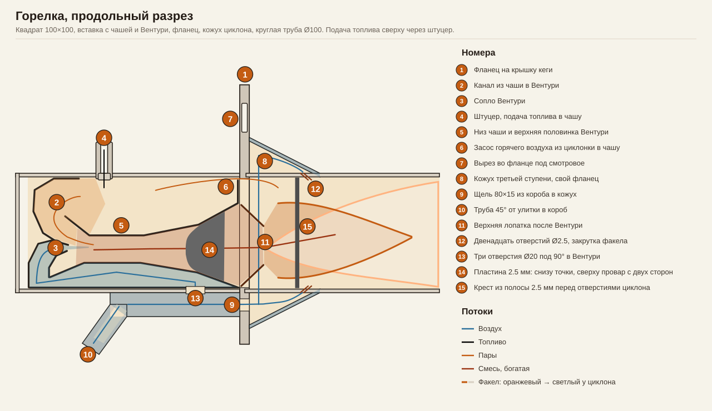
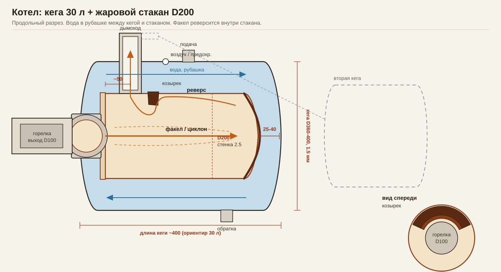
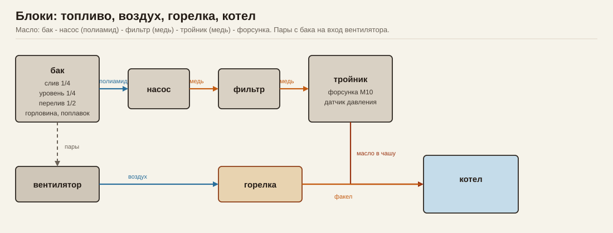
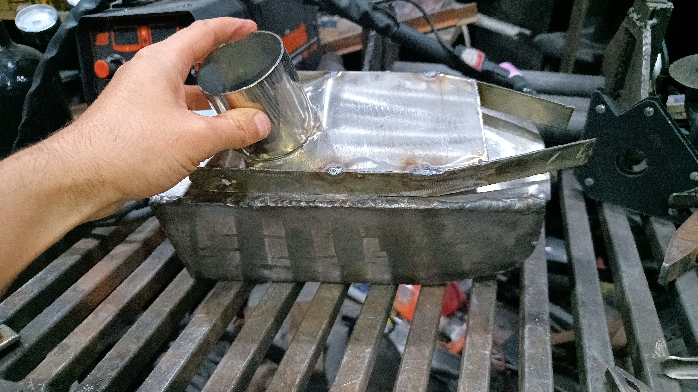
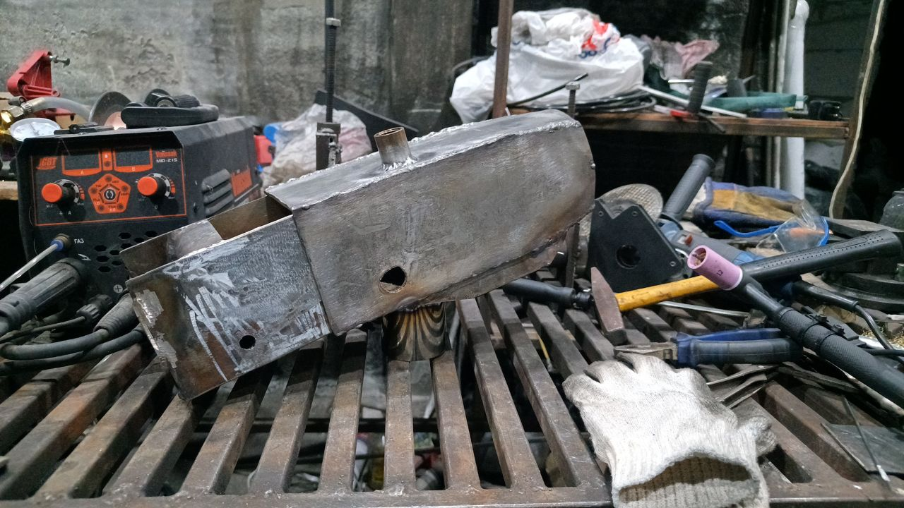
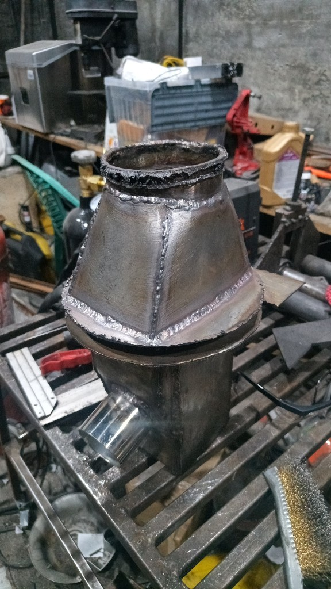

# Жидкотопливная горелка и котёл из кеги 30 л

Документация горелки с принудительным воздухом и испарительной чашей, плюс теплообменник: горизонтальная нержавеющая кега 30 л и жаровой стакан внутри. Ориентир съёма с одной кеги — порядка **10 кВт**.

Схемы горелки: [разрез с размерами (PDF)](./горизонталка_размеры.pdf), [номера](./горизонталка_номера.svg), [блоки установки](./схема-блоков.svg). Модель: [горизонталка.scad](./горизонталка.scad) — в SCAD круглая труба Ø90, по факту выход **Ø100**.

---

## Конструктивные узлы горелки

Описанная **внутренняя вставка** (поз. **2–6**, **11**, **13**, **14**) — версия 1. После запуска №5 выведена из работы, текст оставлен для истории. Внешний модуль, фланец **(1)**, кожух **(8)**, циклон **(12)** и крест **(15)** остаются.

### 1. Внешний модуль (за пределами котла)

* **Корпус:** профильная труба **100×100 мм**.
* **Нагнетание:** турбовентилятор (турбина и корпус Kiturami, мотор от аккумуляторной болгарки, ESC 3S, БП 12 В). Труба 45° **(10)** в нижний короб, дальше воздух делится на **(13)** и **(9)**.
* **Проход в Вентури (13):** три отверстия **Ø20 мм**, около **940 мм²**, под **90°** к коробу. В модели здесь было прямоугольное окно.
* **Проход в циклонку (9):** щель **80×15 мм**, **1200 мм²**, прямо в кожух. В модели был круг **Ø18**.

### 2. Внутренняя вставка

* **Штуцер подачи топлива (4):** отверстие сверху в крыше чаши, через него капает масло.
* **Чаша и верх Вентури (5):** низ испарительной чаши и верхняя половинка сопла Вентури — один контур. Сужение/расширение засасывает пары. Основная доля воздуха горелки идёт через горло; ряд **(12)** по площади забирает около пятой. Смесь уходит вправо в круглую трубу.
* **Засос в чашу (6):** горячий воздух из циклонки. Десяток пропилов диском **1.25 мм** на **2–3 мм** (около **30 мм²**) и сверху щель до **1 мм**, оттуда же. По ходу запуска №4 передняя часть чаши доработана: **5–6** треугольных вырезов, засос сильно увеличен.
* **Канал из чаши в Вентури (2):** щель около **95×10 мм**, **950 мм²**. Пары идут в горло эжекции.
* **Подача воздуха (3):** сопло Вентури — пластина шириной **95 мм** с **6** зубцами высотой **2.5 мм**, **5** каналов = **5** ровных струй вдоль нижней кромки (суммарно на глаз порядка **35–40 мм²**, не замерялось). Нижняя часть Вентури выпрямлена, обварено без щелей.
* **Узел растопки:** газ сбоку в начале канала смешения. Первый выход на режим — газовым факелом, масло самотёком.
* **Электроды розжига:** высоковольтные, резьбы с одного бока после Вентури (ещё нет). Зажигают газ. Искру держать, пока масло не держит факел само, и гасить вместе с газом.
* **Датчик пламени:** термобатарея на АЦП ESP32, с другого бока от электродов. Кончик в факеле сразу за Вентури, буртик в упор штуцера (ещё нет).

#### План рабочей версии

* **Сопло (3):** *(снято, заменено вставкой v2)* пересмотреть нижнюю часть — струя воздуха прижата к нижней кромке Вентури и идёт строго вперёд (пристенная щель), пары из канала (2) входят над струёй.
* **Растопочный газ (только старт):** не сбоку у сопла и не сверху в чашу (там нет воздуха — копоть и риск хлопка), а снизу, под датчиком пламени, в зону у пластины (14). Факел направить вверх-вперёд — лижет дно чаши, не бьёт в датчик в упор. Электроды — искра в струю газа.
* **Датчик пламени:** термобатарея M10×1, фланец с резьбой на отверстие в квадратной части; кончик на краю пламени, без защитной пластины. Сигнал на АЦП ESP32 (ESPHome) через операционный усилитель или ADS1115 + RC-фильтр; логика по скорости падения напряжения, а не по абсолютному порогу.

### Вставка v2 — две ступени (в работе)

* Испарительная чаша, горение начинается в самой чаше.
* **Первичный воздух:** снизу, через мелкие отверстия по бокам чаши (рядами на разной высоте, чтобы при любом уровне масла часть воздуха шла над поверхностью).
* **Вторичный воздух:** сзади поверх чаши, через более крупные отверстия, толкает пламя вперёд.
* **Дожиг:** циклон **(12)** и крест **(15)** остаются; площадь отверстий циклона увеличить (больше отверстий или больший диаметр).
* **Оценка площадей (приближённо, под 10 кВт):** масло ~0.86 кг/ч; воздуха при избытке ~25 % ≈ 18 кг на кг масла → ~3.6 л/с. Давление вентилятора не замерено; при 200–500 Па и коэффициенте расхода отверстий ~0.65 суммарная площадь ~200–300 мм². Распределение примерно: первичный ~30 % (≈ 70–90 мм², напр. 10–12 × Ø3), вторичный ~35 % (≈ 70–100 мм², напр. 3–4 × Ø6), циклон ~35 % (≈ 70–100 мм², напр. 20 × Ø2.5 или 12 × Ø3.2; сейчас ~60 мм²). Сверлить на нижней границе и рассверливать по результатам тестов.

**Раскладка отверстий (первый вариант):**
- Первичный воздух: по 8 × Ø2.5 слева и справа чаши + 5 × Ø2.5 сзади снизу = 21 отверстие, ≈ 103 мм².
- Вторичный воздух: 5 × Ø4 сзади в самом верху, ≈ 63 мм².
- Циклон **(12)**: без изменений, 12 × Ø2.5 ≈ 60 мм²; позже, возможно, рассверлить до Ø4 (≈ 150 мм²).
- Итого ≈ 226 мм². Регулировка — оборотами вентилятора (турбина и корпус Kiturami, мотор от аккумуляторной болгарки, ESC 3S, БП 12 В). Если пламя вялое или не тянет вперёд — сначала рассверлить верхние Ø4.

### 3. Жаровая часть горелки (входит в стакан котла)

* **Фланец на крышку кеги:** стойка **(1)** — часть этого фланца. **(7)** — вырез во фланце под смотровое; закрывается шторкой или герметичным окном с жаропрочным стеклом.
* **Переходник:** квадрат 100×100 → круглая труба **Ø100 мм**.
* **Кожух третьей ступени (8):** от своего фланца к круглой трубе. Фланец прижимается к фланцу горелки: куски шпилек из нержавейки вварены, зажим гайками. Питается щелью **(9)** из нижнего короба. Жаровая труба **Ø100** приварится к этому кожуху, отдельно съёмной не будет.
* **Лопатка (11):** сверху после Вентури, подтормаживает струю. Проектировалось сжатие факела с четырёх сторон, сделана только верхняя; пока так и оставить.
* **Циклон (12):** **12** отверстий **Ø2.5 мм**, около **60 мм²**, всегда открыты. Последний воздух в горелке, далеко за Вентури; в котле подмеса больше нет. В модели было **25×Ø2.5**. Воздух из кожуха закручивает факел.
* **Крест:** полоса **2.5 мм**, правее лопатки **(11)**, в **5 мм** перед рядом **(12)**.

---

## Регламент запуска

1. Датчик пламени в режим ожидания.
2. Клапан газа, искра на разрядник, вентилятор на минимуме. Газ загорается.
3. Газовый факел прогревает чашу и канал до испарения масла.
4. Подача масла. Масло вскипает, пары каналом **(2)** идут в Вентури.
5. Датчик видит стабильное пламя масла. Газ и разрядник выключаются. Обороты вентилятора — под рабочую мощность.

---

## Котёл (теплообменник)

Горизонтальная кега **30 л, нержавейка ~1.5 мм** — водяная рубашка. Внутри — жаровой стакан **Ø200 мм, стенка 2.5 мм**. Горелка (Ø100) на **передней крышке**. Дымоход врезан в **обечайку кеги сверху**, примерно **50 мм** от этой крышки: гильза через водяную рубашку в стакан (швы к кеге и к стакану). Вода только между кегой и стаканом; газы внутри стакана.

Ход газов: факел в заднюю стенку, реверс **по своду** к дымоходу, у козырька огибание вниз и в трубу. Ориентир съёма с одной кеги — порядка 10 кВт. Вторая кега на выхлопе — позже, конвективная секция.

### Задник

Не 2.5 мм, а диск из дна нержавеющей сковороды **~5 мм**, если дно **монолитное** (не сэндвич с алюминием). Слабый магнетизм при отказе индукции — нормально для аустенита после штамповки; варить как 304 (308L / 309L).

Задник **мокрый**: снаружи вода, щель до днища кеги **25–40 мм**, чтобы не встать паровая подушка. Сухой диск в факеле прогорит независимо от толщины. Выпуклость сковороды удобнее вогнуть к факелу (пузо в воду). Борта сковороды не нужны — только круг под Ø200.

### Козырёк

Пластина внутри стакана, сверху, **правее дымохода** (глубже в топку). Реверс по своду упирается в неё, огибает снизу и уходит в трубу. Нижняя кромка выше оси горелки. На виде спереди — сектор по верхней дуге стакана.

На первом огне можно без козырька. Кольца и шнек **в факеле** не ставить.

### Обвязка (минимум)

* подача сверху / сзади рубашки, обратка снизу;
* воздух в верхней точке и предохранительный клапан;
* расширительный бак;
* не гонять котёл ледяной обраткой (смеситель или большой объём системы).
* Для отработки клапан «как у газа, строго 60 °C» не панацея: сера даёт более высокую кислотную точку росы. Клапан всё равно полезен, чтобы не кормить теплообменник холодной водой.

---

## Топливо

Трасса к форсунке собрана. От тройника (форсунка + датчик давления, вход M10) медная трубка на фильтр, от фильтра до насоса снова медь, от насоса до бака — полиамид.

Бачок ещё собрать: снизу слив, сбоку прозрачная трубка уровня на двух фитингах с тройниками — слив и уровнемер на **1/4**. Сверху штуцер **1/2** под слив перелива и дюймовая горловина. Поплавковый датчик уровня. Отвод воздуха с бака на вход вентилятора, чтобы пары шли в топку с воздухом, а не в помещение.

---

## Результаты тестов

### Запуск №1 — 12.10.2026
**Изменения перед тестом:** жаровой трубы и циклона **(8, 12)** нет; проход **(9)** открыт, кожуха нет.

**Топливо:** чистое масло, затем растворитель.

**Ход:** на режим не вышел. Чистое масло не завелось; с растворителем слабое пламя в районе Вентури, сильнее не разгоралось.

**Выводы:**
- Открытый проход **(9)** без кожуха — дыра из короба мимо эжекции, не хватает тяги, чтобы затягивать пары из чаши в Вентури.

**Дальше:**
- Кожух и фланец уже есть: **(9)** кормит кожух, не улицу.

### Запуск №2 — 12.10.2026
**Изменения перед тестом:** подправлено сопло Вентури (поток воздуха прямо); доделан кожух циклонки (8).

**Топливо:** растворитель, разовая заливка в чашу.

**Ход:** розжиг газом ~1 мин, вентилятор на минимуме. Пламя растворителя вспыхивало, но при убирании газа сразу гасло. Устойчивое пламя начало появляться, когда растворитель в чаше уже заканчивался.

**Выводы:**
- Жара растворителю хватает; проблема — недостаточный прогрев тракта и отсутствие постоянной подачи.
- Минимальные обороты вентилятора на переходе всё ещё сносят слабое пламя.
- Газ убирать плавно, только когда жидкое топливо держится само.

**Дальше:**
- Капельная подача: бензостойкая трубка, металлический участок у штуцера (4), игольчатый краник, отсечка.
- Прогрев газом дольше (несколько минут), особенно для масла.
- Регулировка воздуха ниже минимума на старте (заслонка).
- При необходимости — стабилизатор пламени за Вентури.

### Запуск №3 — 14.10.2026
**Изменения перед тестом:** добавлены пластина **(14)** (попытка flame holder) и крест **(15)** перед отверстиями циклона; капельная подача.

**Ход:** практически без улучшений. Слабое пламя держалось только на экстремально минимальных оборотах вентилятора (почти не дул): пламя шло из засоса **(6)** вперёд и затягивалось обратно в Вентури. При малейшей прибавке воздуха срывалось, дальше только дым вперёд.

**Наблюдения:** щель сопла **(3)** неровная — в середине почти сомкнута, сверху и снизу шире, кромки в окалине; струя рваная. Сужение после сопла через 20–30 мм; вертикальное расширение до пластины **(14)**, за ней второе сужение лопаткой **(11)** — по сути два горла подряд, смесь снова разгоняется там, где должно стоять пламя.

**Выводы:**
- Уменьшать площадь сопла в разы не первоочередно: скорость струи и так выше скорости горения, срыв станет сильнее.
- Пламени не за что зацепиться: после пластины **(14)** нет зоны торможения, лопатка **(11)** разгоняет поток.
- Дым вместо огня — пары есть, но смесь не горит; вероятно, чаша остывает после снятия газа (нет обратной связи по теплу).
- Широкий канал **(2)** даёт слабое разрежение у среза сопла.

**План на запуск №4** (менять по одному):
- Выровнять щель сопла **(3)** подгибом пластин по щупу, 1.5–2 мм по всей длине, кромки зачистить.
- Отогнуть лопатку **(11)**, чтобы за пластиной **(14)** поток расширялся, а не сужался.
- Насверлить отверстия в лопатке **(11)**, чтобы работала как стабилизатор.
- Термопара на чашу — смотреть, остывает ли после снятия газа.
- На будущую версию: съёмное сопло (вставка на фланце/винтах), чтобы менять варианты без распила.

### Запуск №4 — 16.10.2026
**Изменения перед тестом:** новое сопло **(3)** — пластина шириной 95 мм с 6 зубцами высотой 2.5 мм, 5 каналов = 5 ровных струй вдоль нижней кромки (суммарно на глаз порядка 35–40 мм², не замерялось); нижняя часть Вентури выпрямлена; всё обварено без щелей. По ходу теста доработана передняя часть чаши: 5–6 треугольных вырезов, засос **(6)** сильно увеличен.

**Ход:** с новым соплом эффекта ноль. После увеличения **(6)** — коптящее горение в чаше, немного дыма в Вентури. Пламя в чаше и дым в Вентури на обороты вентилятора практически не реагировали. Масла ~100 г за 10 мин (~0.6 кг/ч, ~7 кВт), сгорело не всё. Контрольный опыт: камера между **(11)** и **(12)** набита картоном — пламя мощно идёт вперёд, циклон работает; вентилятор мощный.

**Выводы:**
- Воздушный тракт и циклон работают; форма сопла не главная причина.
- Узкое место — испарение и подача паров: Вентури почти не затягивает пары, а в чаше воздух только самотёком через **(6)** (отсюда копоть и независимость от оборотов).
- Вероятно, чаше не хватает температуры (нужно 300+ °C): масло испаряется не полностью, факел чашу не греет, воздух под чашей может её охлаждать.

**Дальше:**
- Измерить температуру дна чаши (тепловизор — по участку с чёрной жаростойкой краской или каптоном, нержавейка занижает; либо термопара).
- Если холодная — греть чашу собственным пламенем и/или убрать охлаждающий поток снизу.
- Рассмотреть схему «горение в чаше + вторичный воздух из сопел/циклона на дожиг»: больше (подогретого) воздуха в чашу, чтобы в Вентури выходило уже горящее пламя.

### Запуск №5 — 17.10.2026
**Ход:** горения добиться удалось, пламя синее (смесь правильная), но без стабилизатора срывается при малейших колебаниях. Тяга паров из чаши в Вентури практически отсутствует: как ни грел, пламя не доходило даже до циклона **(12)**.

**Итог:** схема с эжекцией паров воздушным Вентури не работает. **Вариант закрыт, текущая вставка (чаша + Вентури, три ступени воздуха) выводится из работы.**

---

## Порядок сборки и прогресс

### Горелка

- [x] Пластины вставки
- [x] Сердечник сварен, без циклона
- [x] Короб воздуха, труба, сужение за фланец
- [x] Посадка форсунки, тройник, датчик давления, вход M10
- [x] Отверстие под газ
- [x] Штуцер газа
- [x] Вентилятор: улитка от газового котла, мотор аккумуляторной БШМ BLDC
- [x] Трасса масла: медь тройник–фильтр–насос, полиамид насос–бак
- [ ] Тест: растопка газом, масло самотёком — без трубы и при открытом (9) не пошло; повтор с кожухом
- [ ] Бачок: слив и уровнемер 1/4, перелив 1/2, горловина 1", поплавок, пары на вентилятор
- [ ] Штуцер термобатареи за Вентури
- [ ] Электроды розжига с одного бока после Вентури, термобатарея с другого
- [ ] Съёмное сопло Вентури (вставка на фланце/винтах) — следующая версия
- [x] Фланец на горелке
- [x] Кожух третьей ступени со своим фланцем, прижимается к фланцу горелки
- [x] Шпильки на фланце кожуха, зажим гайками
- [ ] Круглая жаровая труба, приварить к кожуху циклонки
- [x] Отверстия циклона: 12×Ø2.5, всегда открыты
- [ ] Вставка v2: чаша, первичный воздух по бокам, вторичный сверху сзади
- [ ] Циклон (12): увеличить площадь отверстий

### Котёл

- [ ] Вырез в крышке кеги под фланец горелки
- [ ] Жаровой стакан Ø200 × 2.5 мм
- [ ] Мокрый задник ~5 мм (диск сковороды, не сэндвич)
- [ ] Дымоход в обечайку, ~50 мм от крышки, гильза через рубашку
- [ ] Сборка кеги со стаканом, штуцеры рубашки
- [ ] Гидроиспытание
- [ ] Козырёк правее дымохода (первый огонь можно без него)
- [ ] Вторая кега на выхлопе — позже

