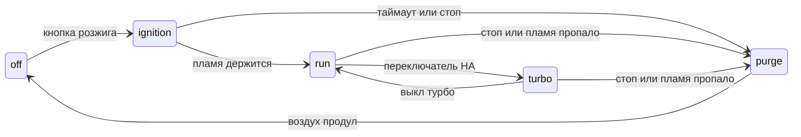

# Контроллер горелки

ESP32 DevKit, прошивка [oil-burner_esp32.yaml](../../tech-notes/oil-burner_esp32.yaml). Разводка этой монтажки. Схема 2025-01-16 — прежний насос и вентилятор.

## Пины

| Куда | Пин |
| --- | --- |
| ESC1 воздух, сторона 3.3 В канала 1 | GPIO25 |
| ESC2 насос, сторона 3.3 В канала 2 | GPIO26 |
| Питание обоих ESC, ключ | GPIO23, высокий = вкл |
| Прямой выход | GPIO22 |
| Каналы 3 и 4 | не используются |
| Термобатарея пламени «+» | GPIO33, 100 кОм на GND |
| Термобатарея «−» | GND |
| MAX6675 SO | GPIO12 |
| MAX6675 SCK | GPIO14 |
| MAX6675 CS | GPIO27 |
| MAX6675 VCC | 3.3 В |
| Термопара K теплоносителя | клемма MAX6675 |
| Кнопка розжига | GPIO19, 10 кОм на 3.3 В, контакт на GND |
| Кнопка стоп | GPIO21, 10 кОм на 3.3 В, контакт на GND |
| Свободный вход | GPIO18, 10 кОм на 3.3 В, контакт на GND |

MOSI GPIO13 в шине SPI, к термопаре не подключается.

Термобатарея горячая даёт около 1 В. Плюс на GPIO33, минус на GND, 100 кОм с GPIO33 на GND. Обрыв читается как 0 В.

Кнопки розжига и стопа и свободный вход GPIO18 замыкают пин на GND. 10 кОм на GPIO18, GPIO19 и GPIO21 — к 3.3 В.

MAX6675 питать от 3.3 В: SO не должен быть 5 В на пине ESP.

## Питание

Вход LM2596 — 12 В. Выход выставить **5.0 В**: на VIN ESP32 и на HV преобразователя. LV преобразователя — 3.3 В ESP.

Земля общая: ESP, LM2596, преобразователь, оба ESC, термобатарея, MAX6675.

Силовое питание моторов — у ESC. Ключ GPIO23 разрывает плюс обоих ESC сразу, высокий уровень включает. GPIO22 такой же прямой выход. Земля общая, её не разрывать. На плату с ESC ещё сигнал. Провод 5 В BEC не подключать. Обычные цвета: чёрный — земля, белый или жёлтый — сигнал, красный — не подключать.

Стендовая прошивка: `Flame`, `Coolant`, ручные `ESC air us` и `ESC pump us` (1000–2000 мкс, старт 1000), ключ `ESC power` после включения выключен.

## Преобразователь 3.3/5 В

Четыре одинаковых канала, полевик, без инверсии. Затвор на 3.3 В. Импульс сервы проходит как есть: 50 Гц, высокий импульс.

```
3.3 В ----+---------------- затвор
          |
        10 кОм
          |
GPIO -----+---- исток
               |
              |>|  диод к стоку
               |
              сток ----+---- сигнал ESC
                       |
                     10 кОм
                       |
                      5 В
```

| Модуль | Куда |
| --- | --- |
| LV | 3.3 В |
| HV | 5 В LM2596 |
| GND | общий |
| LV1 | GPIO25 |
| HV1 | сигнал ESC воздуха |
| LV2 | GPIO26 |
| HV2 | сигнал ESC насоса |

## Режимы

На старте оба ESC в стоп, около 1000 мкс: арм, моторы стоят. 1000 мкс — это стоп, не капель. Капель задаётся `Pump min us`.



- Розжиг и рабочий — одни импульсы: воздух `Air min us`, насос `Pump min us` (1–2 капли/с). Кнопки GPIO19 и Ignition.
- В рабочий режим обороты не меняются: `Flame` выше `Flame threshold` дольше `Flame hold`.
- Турбо — `Air turbo us` и `Pump turbo us` (~2 л/ч). Переключатель Turbo, только из рабочего.
- Стоп, таймаут розжига, пропажа пламени, теплоноситель выше `Coolant max`: насос сразу `Pump stop us`, воздух ещё `Air min us` на `Purge time`, потом оба в стоп. Кнопки GPIO21 и Stop.

Числа в HA сохраняются: `Air stop us`, `Air min us`, `Air turbo us`, `Pump stop us`, `Pump min us`, `Pump turbo us`, `Flame threshold`, `Flame hold`, `Ignition timeout`, `Purge time`, `Coolant max`.
