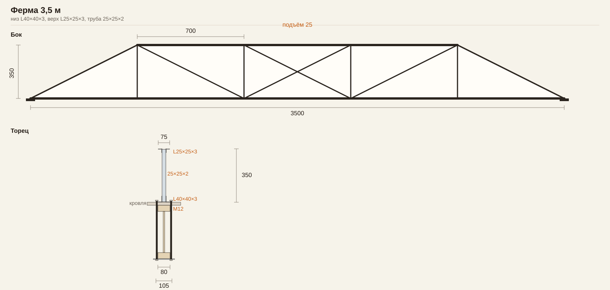

# Ферма 3,5 м

Стоит на кровле. Концы нижнего пояса опираются на те же стены, что и деревянные двутавры. Шпильки M12 подтягивают двутавр снизу: две шпильки по бокам полки 80 мм, под балкой полоса 140×5, гайки на полках нижних уголков.

Пролёт 3500, высота 350, подъём 25. Панели по 700. Концы со скосом: нижний пояс на всю длину, верхний от 700 до 2800. Решётка Pratt, в средней панели крест. Труба 25×25×2 заходит между уголками почти на всю высоту полки.

- Низ: 2× L40×40×3, между вертикальными полками труба 25×25×2. Ширина 105.
- Верх: 2× L25×25×3, раздвинуты той же трубой. Ширина 75.
- Решётка и стойки: труба 25×25×2.
- Деревянный двутавр на торце: высота 350, полки 80×40, стенка 10.

Три фермы, через балку. Полоса нагрузки 1,6 м. Уголки верхнего пояса связать между собой примерно каждые 200 мм: из плоскости пояс свободен на 2,1 м. Варить на земле.

Нагрузка по СП 16, Ry=240, высота между центрами поясов 330 мм. С прокладками каждые 200 мм ферма держит около 6,5 кН/м, это 4 кПа на полосе 1,6 м. Связь уголков только в узлах — около 3 кН/м. Снег III и кровля 0,7 кПа дают расчётные 3,4 кПа. Точка в середине пролёта — около 1000 кг. При 400–500 кг низ прогибается упруго: панель 700 мм на 1–1,3 мм, точка вместе с фермой на 2,5–3 мм.
