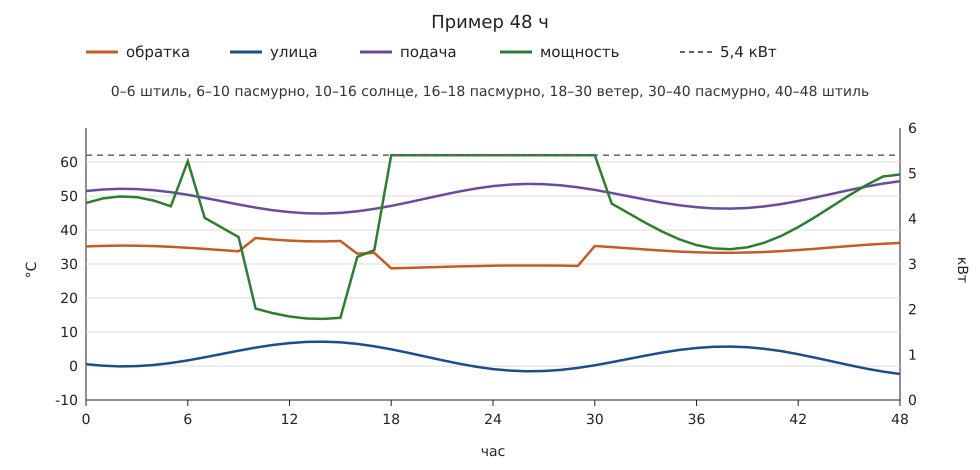

# Отопление старого дома, ТЭНы

Отопление старого дома электрическими ТЭНами. Секреты Wi‑Fi — `secrets.yaml`, в репозиторий не входят. Часовой пояс устройства — Europe/Moscow.

## heatingOld

Котловой контур. Плата ESP8266, NodeMCU v2. Файл: [heater_esp32.yaml](heater_esp32.yaml). Имя в HA: `heatingOld`.

1-Wire на GPIO5, Dallas, разрешение 12 бит.

| Датчик | Имя | Период |
| --- | --- | --- |
| верх контура | TempHeaterTop | 30 с |
| низ контура | TempHeaterDown | 30 с |
| улица | TempOut | 120 с |
| помещение | TempIn | 60 с |

ТЭНы, slow PWM 30 с:

| Выход | Пин | Мощность |
| --- | --- | --- |
| heater1 | GPIO15 | 2 кВт |
| heater2 | GPIO12 | 4 кВт |

GPIO14 и GPIO13 в конфиге есть, к ТЭНам не подключены.

Считается каждые 30 с по приходу `TempHeaterTop`.

Уставка комнаты `targ` — дневная, из Climat Desired Temp. Время с Home Assistant, пояс Europe/Moscow. Если время ещё не пришло, остаётся дневная. При включённом день/ночь и часе в интервале Night Start…Night End (по умолчанию 22…6, конец не входит) `targ` берётся из Climat Night Temp. Сейчас ночь с 22:00 до 06:00. Следующие Morning Boost Time минут (по умолчанию 60) к дневной уставке прибавляется `Morning Boost · max(дневная − TempOut, 0) / 8`. 8 °C — перепад, при котором поле берётся как есть (по умолчанию 2 °C: улица 13 °C и дневная 21). Затем снова дневная. Датчик `Climat Period`: `night`, `boost`, `day` или `no time`.

```
P_кВт = max(P_база · M(x) · (1 + 0,15·(targ − TempIn)), 0)
P_база = V · k · (targ − TempOut) / 860
ΔT_эталон = max((верх − TempOut) · (0,18 + 0,12·k), 1)
x = (верх − низ) / ΔT_эталон    # не ниже 0, в пределах 0,2…2
M(x) = (((M4·x + M3)·x + M2)·x + M1)·x + M0
```

`P_база` — потери от улицы и уставки. Эталонный перепад — какая должна быть обратка при этой подаче и улице. x больше 1, обратка холоднее эталона (ветер, дождь): M поднимает мощность. x меньше 1, обратка теплее (солнце): M снижает. Кухня остаётся множителем `1 + 0,15·(targ − TempIn)`. Команда после этого не выше 90 % суммы ТЭНов (2+4 кВт → 5,4 кВт).

Пример двух суток, не замер. k = 1, кухня 20 °C. Солнце, пасмурно и штиль, ветер двигают только обратку. Подача по графикам 21–26.11: `31 + 6,5·P` — 1,2 кВт около 38 °C, 1,8 кВт 41 °C, 5,4 кВт 64 °C. Слева °C, справа кВт. Штрих 65 °C — отсечка по верху.



В ШИМ идут ватты: `P_кВт · 1000`. Скважность берётся из `Q_need`, период slow PWM 30 с. До 1 кВт работает ТЭН 2 кВт. Выше и до 4 кВт — только ТЭН 4 кВт: при 1.8 кВт это 45 % времени. Дальше оба. Отсечка 65 °C смотрит сырой верх.

```
P ≤ 1 кВт    → ТЭН1 = P / 2 кВт, ТЭН2 = 0
P ≤ 4 кВт    → ТЭН1 = 0,         ТЭН2 = P / 4 кВт
иначе        → ТЭН1 = 1,         ТЭН2 = (P − 2 кВт) / 4 кВт
```

`Heat Power` — среднее `P` за 10 отсчётов. `Heater PWM` — `P / (мощность ТЭН1 + мощность ТЭН2) · 100`. При 2+4 кВт: 0.8 кВт → 13 %, тэн 4 кВт на 50 % (2 кВт) → 33 %, оба на 100 % → 100 %. Верх выше 65 °C — оба ТЭНа выключаются.

Константы в HA: `V` — объём, м³; `k` — удельные потери; `M4`…`M0` — коэффициенты полинома; мощность каждого ТЭНа. Пока `V` или `k` равны 0, `Q_need` не задаёт нагрев.

Рабочие значения: `V = 125`, `k = 0.95`, `G = 170`. Ночь 22.10, улица 12 °C, кухня 20.3 °C: при `k = 0.7` выходило ~800 Вт и дом остывал. На эту точку нужно 1000–1200 Вт. `k = 0.95` даёт ~1150 Вт, пока кухня 20.3 °C, и ~1070 Вт, когда она уже на уставке 21. При −10 °C и комнате на уставке ~3.7 кВт, при −20 °C ~4.9 кВт.

Если на ровном режиме `Heat Power` и перепад не сходятся: `G = Heat Power · 1000 / (1.163 · (верх − низ))`, затем `k` умножить на `170 / G`.
