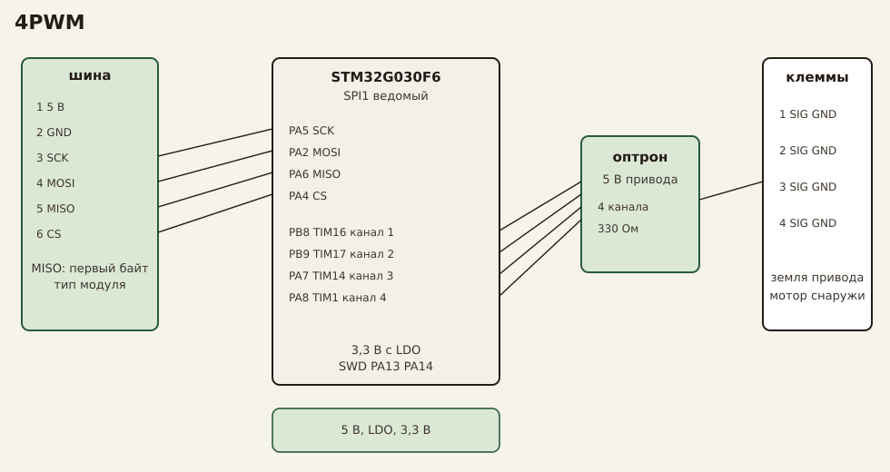

# 4PWM

STM32G030F6P6, TSSOP20, SPI-ведомый. Четыре аппаратных ШИМ, у каждого свой таймер. Сервопривод и ESC. Ток мотора через плату не идёт.



## Шина

Боковые разъёмы — как у всех модулей на [шине](bus.md). Верхний CS левого разъёма сидит на PA4. Контакт на один ниже поднимается на верхний CS правого разъёма.

| Сигнал левого разъёма | Куда |
|---|---|
| 5 В, GND | питание модуля и буфера |
| SCK | PA5 |
| MOSI | PA2 |
| MISO | PA6 |
| CS0 | PA4 |

Первый байт MISO — тип `0x05`.

SPI: ведомый, режим 0, 8 бит, старший бит первый, такт до 1 МГц. 3,3 В для микроконтроллера снимает LDO с 5 В.

## Выходы

| Канал | Таймер | Нога | Выход |
|---|---|---|---|
| 1 | TIM16_CH1 | PB8 | оптрон |
| 2 | TIM17_CH1 | PB9 | оптрон |
| 3 | TIM14_CH1 | PA7 | оптрон |
| 4 | TIM1_CH1 | PA8 | оптрон |

На каждом канале свой оптрон. Светодиод от таймера. Сторона привода питается его 5 В, земля сигнала — земля привода. До первого годного кадра импульсов нет.

Частота канала 50…400 Гц. Импульс 544…2400 мкс. Угол сервопривода 0…180 лежит в длительности импульса. Число вне диапазона модуль не применяет и держит прежнее.

## Кадр

По CS база пишет 16 байт, младший байт первый. На канал четыре байта: частота, Гц, uint16, затем импульс, мкс, uint16. Порядок каналов 1…4.

```yaml
- type: 4PWM
  channel:
    - ch: 1
      id: flap
      frequency: 50Hz
      pulse: 1500us
    - ch: 2
      id: esc
      frequency: 400Hz
      pulse: 1000us
```
