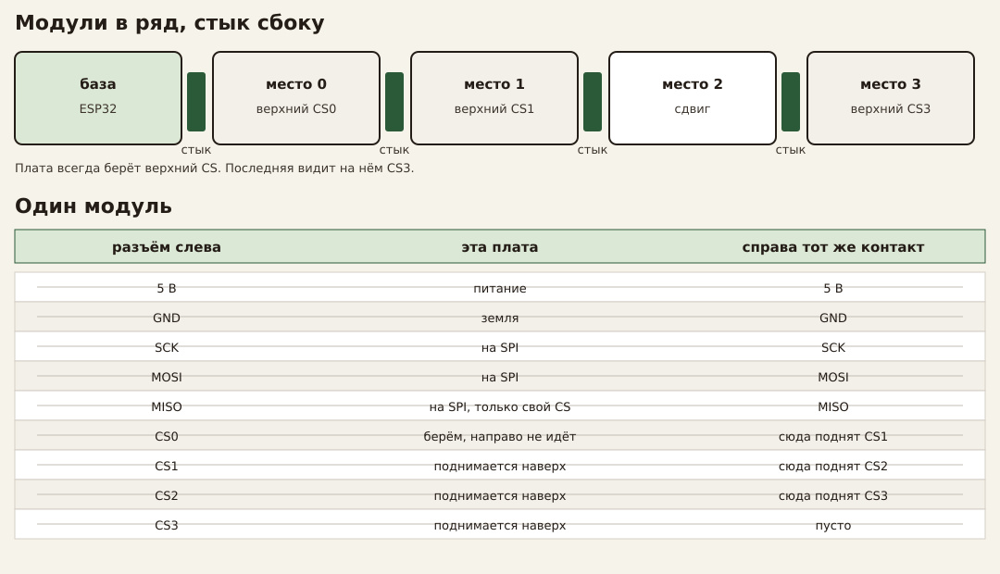

# Шина модулей

Общая для `8DI`, `8DQ`, `4AI`, `2AQ`, `4PWM`. Платы стыкуются сбоку в ряд: база, затем место 0, 1, 2, 3. У платы нет своего адреса. Номер — место в ряду.

Разъём слева и справа одинаковый. Верхний контакт CS плата всегда берёт себе. Имя контакта справа то же. На верхний поднимается сигнал, который слева был на один ниже. Свой верхний направо не идёт: его забрала эта плата. У места 0 сверху сигнал CS0, у последней сверху CS3.

Пустое место — вставка без каналов. Она тоже сдвигает CS, иначе номера дальше по ряду съедут.

MISO плата выдаёт, только пока её CS0 низкий. На линии подтяжка к 3,3 В. SPI 3,3 В, режим 0.

Первый байт ответа — тип. У одинаковых плат код один.

| Код | Модуль |
|---|---|
| 0x01 | 8DI |
| 0x02 | 8DQ |
| 0x03 | 4AI |
| 0x04 | 2AQ |
| 0x05 | 4PWM |
